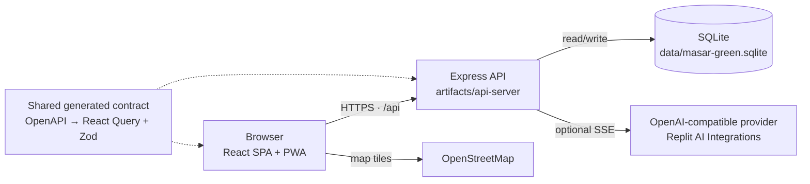

# Masar Green

**A bilingual Dubai mobility prototype that compares greener journeys and turns simulated carbon savings into a rewards wallet.**

[Live demo](https://masa-platform.replit.app/) · [Architecture](docs/ARCHITECTURE.md) · [Contributing](CONTRIBUTING.md) · [Security](SECURITY.md) · [MIT License](LICENSE)


> **Concept prototype.** Routes, live vehicle positions, NOL balances, PIN sign-in, verification, Green Credits, partners and cash values are simulated. Masar Green is **not affiliated with RTA, NOL or any government entity**. Do not enter a real card number, PIN or personal data.

## What is Masar Green?

Masar Green is a mobile-first web app for Dubai commuters. It brings trip planning, public-transport information, carbon accounting and a rewards wallet into one bilingual experience. A commuter can compare a metro, bus, tram, water-taxi, taxi, bike or walking option, see the estimated cost, time, crowding and CO₂ impact, then start a simulated journey and earn Green Credits for the carbon saved.

The project explores a simple idea: make the greener choice the easiest choice to understand, and give commuters a tangible reason to keep making it.

### The problem

Dubai commuters often have several ways to make the same journey, but the trade-offs are spread across different apps. Cost, journey time, crowding, accessibility and environmental impact are rarely visible side by side. Rewards programmes also tend to be disconnected from the transport decision itself.

### The proposed solution

Masar Green puts those trade-offs in one place:

- **Compare first, travel second.** Six conceptual route options are scored on price, time, crowding and carbon.
- **Make the impact visible.** A transparent carbon engine converts avoided car emissions into Green Credits and an indicative AED value.
- **Reward verified behaviour.** Simulated tap-in/tap-out and plausibility checks determine whether a trip earns anything.
- **Keep the wider system in view.** Employer and city roles see anonymised, aggregated reports rather than individual journeys.
- **Design for the actual audience.** English and Arabic, RTL layout, dark mode, large tap targets and an installable PWA.

## Hackathon background

Masar Green was built by a team during a hackathon. The implementation was developed collaboratively in Replit with the Replit AI Agent, and the original development history is preserved in this repository. Individual contributor names are intentionally not listed here; the repository describes the work and its boundaries rather than claiming individual authorship.

The project is a **concept prototype**, not a production transport, payments or government service. The live demo is provided to make the implementation easy to evaluate.

## Implemented features

### Trip planning and live map

- 42 seeded Dubai destinations with English and Arabic names.
- Six conceptual multimodal options per journey: metro, bus, tram, water taxi, taxi, and bike/e-scooter, with walking legs.
- Comparison by price, total time, CO₂, crowding, walking time and transfers.
- Sorting by greenest, cheapest, fastest or least crowded, plus a step-free/accessibility filter.
- Leaflet + OpenStreetMap route previews with colour-coded legs.
- Live map with server-simulated vehicles that move every five seconds, transport layers, ETAs and crowding labels.
- Explicit "start trip" and "end trip" simulation; accelerated completion is labelled as a simulation.

### Carbon engine and trip verification

- Server-side, configurable emission factors in `artifacts/api-server/src/masar/carbon.ts`.
- Baseline comparison against a solo petrol car.
- Credits are rounded down, capped per Gulf Standard Time day, and expire after 12 months.
- Mock verification score based on simulated tap-in/tap-out and GPS plausibility.
- Pending-review outcomes for missing tap-out, impossible speed, route mismatch, duplicate journeys within two hours, or other failed checks.
- Duplicate and anti-abuse fingerprints survive trip-history deletion.

### Green Wallet

- Green Credits balance, AED value, earned/redeemed/expired history and expiry warnings.
- Simulated NOL top-up, partner vouchers with QR codes, and tree/solar donation options.
- Oldest-expiring credit lots are consumed first.
- Bank withdrawal is a confirmation-only **coming soon** flow: no bank details are collected and no credits are debited.

### Challenges, community and referrals

- Weekly challenges with progress and claimable bonuses.
- Individual, workplace and neighbourhood leaderboards.
- Badges for first trip, streaks, carbon milestones and donations.
- Referral links with a reward for the inviter only after the invited commuter completes a first **verified** trip.

### Employer and city reporting

- Role-protected employer and city accounts.
- Employer view: aggregate commute CO₂, participation, team breakdown and CSV export.
- City view: date-range filtering, aggregate mode breakdown, peak crowding, coarsened origin/destination heatmap and CSV export.
- Groups with fewer than five people are suppressed. Employer output never contains individual trip locations.

### Engagement and support

- In-app service-alert inbox with read receipts; no SMS, email or push delivery.
- Commuter feedback with references, statuses and simulated city review replies.
- Sponsorship enquiries and labelled campaign placements with indicative impression/click aggregates.
- Read-only AI assistant that answers product questions and streams responses. It has no tools for changing trips, cases, balances or alerts.

### Privacy, accessibility and PWA

- English/Arabic switching with RTL support, dark mode and WCAG-oriented controls.
- Consent controls for location and trip tracking.
- Personal data export and journey-history deletion.
- Browser-workspace isolation for free-text feedback and sponsorship enquiries.
- Installable PWA with an offline shell; API responses are never cached.
- Optional Web NFC card-number entry where the browser supports it. It does not authenticate a real NOL card.

## Technology stack

| Layer | Technology |
|---|---|
| Frontend | React 19, Vite 7, TypeScript 5.9, Tailwind CSS 4, Wouter, TanStack Query |
| UI and data visualisation | Radix UI / shadcn-style components, Lucide, Recharts, Leaflet + OpenStreetMap |
| Backend | Node.js, Express 5, TypeScript, Zod |
| Persistence | SQLite via `better-sqlite3`, auto-created and seeded on first API start |
| Authentication | bcrypt PIN hashes, JWT session cookie, revocable server-side session records, rate limiting |
| API contract | OpenAPI 3.1 in `lib/api-spec/openapi.yaml`, Orval-generated React Query hooks and Zod validators |
| AI assistant | OpenAI-compatible streaming client through Replit AI Integrations (optional at runtime) |
| Tooling | pnpm workspaces, esbuild, Prettier, Node's built-in test runner |

## Architecture



The app is a pnpm workspace with one deployable web artifact and one API artifact. The browser talks to the API through a same-origin `/api` path. In Replit, the platform router provides that origin. For local development, Vite proxies `/api` to the API server so cookies and relative requests behave the same way.

The API owns the business rules: route construction, carbon calculations, verification, ledger accounting, referrals, role checks and report suppression. The client is a typed consumer of the generated API contract. SQLite is deliberately local and disposable; the database file is created and seeded automatically and is excluded from Git.

See [`docs/ARCHITECTURE.md`](docs/ARCHITECTURE.md) for the data model, request flows, security boundaries and deployment notes.

## Repository layout

```text
.
├── artifacts/
│   ├── api-server/          # Express API, domain logic, SQLite schema/seeding, tests
│   ├── masar-green/         # React/Vite PWA
│   └── mockup-sandbox/      # Optional design/preview sandbox, not part of the deployed app
├── lib/
│   ├── api-spec/            # OpenAPI source of truth and Orval config
│   ├── api-client-react/    # Generated React Query client
│   ├── api-zod/             # Generated request/response validators
│   ├── db/                  # Unused PostgreSQL template package; retained, not wired into the app
│   └── integrations-openai-ai-server/  # Optional OpenAI-compatible client
├── docs/                    # Architecture notes and overview asset
├── scripts/                 # Maintenance and smoke-test scripts
├── .replit                  # Replit run/deployment configuration
├── .env.example             # Safe environment template
└── pnpm-workspace.yaml
```

## Run locally

### Prerequisites

- **Node.js 22.12+** (Node 24 is used by the Replit environment; `.nvmrc` pins 24).
- **pnpm 10** via Corepack (`corepack enable`) or a global pnpm install.
- A C/C++ toolchain may be needed if a prebuilt `better-sqlite3` binary is unavailable for your platform.

### 1. Install dependencies

```sh
corepack enable
pnpm install
```

### 2. Start the API

In the first terminal:

```sh
cd artifacts/api-server
PORT=8080 \
SESSION_SECRET="replace-with-a-long-random-development-secret" \
NODE_ENV=development \
pnpm dev
```

The API builds and starts on `http://localhost:8080`. On first start it creates and seeds `data/masar-green.sqlite` automatically. No migration step is required.

### 3. Start the web app

In a second terminal, from the repository root:

```sh
cd artifacts/masar-green
PORT=5173 BASE_PATH=/ pnpm dev
```

Open **http://localhost:5173**. Vite proxies `/api` to `http://localhost:8080` by default. Set `API_PROXY_TARGET` if the API runs elsewhere.

The API requires `SESSION_SECRET` at startup. The web dev server requires `PORT` and `BASE_PATH` at runtime, although both now have local defaults so production builds remain reproducible.

### 4. Use the demo accounts

The sign-in screen also exposes one-click demo buttons. The seeded accounts are:

| Role / commuter | Simulated card | PIN |
|---|---|---|
| Amina, regular metro commuter | `12345678` | `1111` |
| New commuter, empty history and onboarding | `87654321` | `2222` |
| Omar, frequent commuter and high wallet balance | `11223344` | `3333` |
| Emirates Future Labs employer admin | `55667788` | `4444` |
| Dubai city analyst | `99887766` | `5555` |

Amina's dashboard can be previewed without signing in. Preview is explicitly labelled. Earning, redeeming, changing settings and submitting reports require a session.

An unrecognised 8–10 digit card creates a **demo-only** account with the supplied 4-digit PIN and then asks for onboarding and explicit consent. This does not prove card ownership and must never be used with a real card.

### Run on Replit

The checked-in `.replit` configuration defines the managed API and web workflows. Use Replit's **Run** control; the platform provides `PORT`, `BASE_PATH` and the same-origin routing. Add `SESSION_SECRET` as a Replit Secret. The AI assistant is optional and additionally needs the Replit AI Integrations variables listed below.

## Environment configuration

The app reads environment variables directly from the process. Copy `.env.example` as a reference, but export the values in your shell or configure them in Replit Secrets.

| Variable | Required | Used by | Purpose |
|---|---|---|---|
| `SESSION_SECRET` | Yes | API | Signs JWT session tokens. Use a long random value. |
| `PORT` | Runtime | API, Vite | API port (`8080` locally), web port (`5173` locally), or the platform-assigned port. |
| `BASE_PATH` | Runtime | Vite | URL prefix for the web app. Use `/` locally. |
| `NODE_ENV` | Recommended | API, Vite | `development` or `production`. Controls Secure cookies and production logging. |
| `LOG_LEVEL` | No | API | Pino log level; defaults to `info`. |
| `API_PROXY_TARGET` | No | Vite dev | API target for the local `/api` proxy; defaults to `http://localhost:8080`. |
| `AI_INTEGRATIONS_OPENAI_BASE_URL` | No | API | Replit AI Integrations base URL. The assistant returns `503` when unset. |
| `AI_INTEGRATIONS_OPENAI_API_KEY` | No | API | Server-only AI integration key. Never expose it to the browser. |
| `REPLIT_DEV_DOMAIN` | No | Smoke-test script | Host used by `scripts/test-engagement.mjs`. |

No transport API keys, payment credentials or real bank accounts are used. PINs are hashed with bcrypt. Sessions are revocable server-side records delivered in HTTP-only cookies; production cookies are `Secure` and `SameSite=Lax`.

## API and code generation

`lib/api-spec/openapi.yaml` is the source of truth for the REST API. The generated React Query hooks and Zod schemas live in `lib/api-client-react` and `lib/api-zod`.

```sh
pnpm --filter @workspace/api-spec run codegen
```

Run codegen after changing the OpenAPI spec, then typecheck. The API validates requests and response shapes with the generated Zod schemas. The main endpoint groups are:

- `auth`, `profile`, `dashboard`, `locations`, `plan`, `trips`, `map`, `carbon`
- `wallet`, `challenges`, `leaderboard`, `privacy/export`
- `reports` (employer/city), `campaigns`, `sponsorship-enquiries`, `sponsored-placements`
- `service-alerts`, `feedback`, `referrals`
- `openai/assistant/messages` (SSE stream)

## Validation

The repository includes a focused Node test suite for referral qualification and ledger behaviour:

```sh
pnpm test
```

The full typecheck and build are:

```sh
pnpm run typecheck
pnpm run build
```

The engagement smoke test requires a running API and `REPLIT_DEV_DOMAIN`:

```sh
node scripts/test-engagement.mjs
```

The API also exposes `GET /api/healthz` for a quick health check. The live demo was verified reachable at <https://masa-platform.replit.app/>. Browser-based end-to-end tests are not part of this repository; the documented checks are the ones that can be reproduced from the source.

## Security and privacy

- **No production credentials are committed.** The repository contains no `.env` file, API key, database URL or session secret. The original Replit history was scanned before publication.
- **Demo credentials are public by design.** The card/PIN pairs above are seed data for a simulation. They are not staff identities and do not grant access to real transport or payment systems.
- **Prototype-only authentication.** A locally generated card is not a verified NOL card. Do not reuse this authentication model with real users.
- **Local SQLite is not durable production storage.** It has no backup, migration or multi-instance story. Do not store real financial or personal records in it.
- **Rate limits are process-local.** Sign-in, engagement and AI limits reset on restart and are not a distributed abuse-prevention system.
- **Free-text cases are browser-workspace isolated.** This is a demo compromise, not a replacement for private staff authentication.
- **AI chat is sent to a provider.** The app does not persist chat history, but provider retention is outside its control. Basic screening rejects likely card numbers, PINs and email addresses; it is not a complete personal-data detector.

See [`SECURITY.md`](SECURITY.md) for the reporting process and the full prototype security boundary.

## Known limitations

- All transport, NOL, reward, partner and payment data is simulated. Nothing here is an official RTA, NOL or government service.
- Routes and vehicle positions are schematic. They are **not** navigation, live arrivals or a substitute for official journey information.
- There is no automatic real NOL tap-out and no background GPS tracking. Trip completion is an explicit simulation.
- Carbon factors are illustrative assumptions, not certified UAE emissions factors. Tree equivalence is a comparison, not evidence of planting or an offset.
- SQLite is local to one process. The data should not be assumed to survive a new deployment.
- Bank withdrawal is a confirmation-only coming-soon flow. No money moves.
- Push, SMS and email delivery are not connected; the notification preference only saves the preference.
- The AI assistant is optional, read-only and limited to curated product facts. It has no live transit feed.
- The unused PostgreSQL package in `lib/db` is a template remnant and is not part of the running app.
- The repository has one API test suite, not full browser E2E coverage.

## Future improvements

1. Replace seeded stations and routes with authorised GTFS/GTFS-Realtime data and a real multimodal routing engine.
2. Integrate an approved NOL/card-linking flow with provider-backed ownership verification.
3. Replace mock verification with signed tap events, consented location checks, replay protection and manual review.
4. Validate local emission, fleet and occupancy factors before claiming real carbon reductions or issuing monetary rewards.
5. Move to durable production storage with backups, migrations, retention and audit controls.
6. Add private staff authentication for feedback and service-alert operations.
7. Connect real partner fulfilment and payments with idempotency, reconciliation and refund handling.
8. Add browser E2E tests, accessibility automation and deployment smoke tests.

## Team and acknowledgements

This was a **team hackathon project**. The repository intentionally does not list individual contributor names or claim awards, roles or outcomes that are not recorded in the source.

Built with the Replit AI Agent in Replit. The project also relies on open-source work from the React, Vite, Express, SQLite, Leaflet, OpenStreetMap, Recharts, Radix UI, Lucide, Orval and pnpm communities. Map data © OpenStreetMap contributors.

## License

Released under the [MIT License](LICENSE). Copyright (c) 2026 Masar Green contributors.

---

**Concept prototype. Not affiliated with RTA, NOL or any government entity. Data is simulated.**
