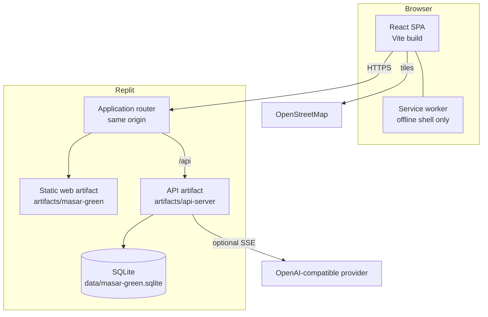

# Architecture

This document describes how the prototype is put together and which boundaries are deliberate. It is written against the current source, not against the original product brief.

## Design goals

- Keep the demo runnable as one small full-stack workspace.
- Make the carbon and rewards rules inspectable and testable on the server.
- Keep simulated transport, money and identity clearly labelled.
- Give employer and city roles aggregate views without exposing individual journeys.
- Preserve a typed contract between the browser and the API.

## Non-goals

Masar Green is not a production transport, identity, payments or government platform. It does not integrate with RTA, NOL, a live GTFS feed, a payment processor, a bank or a push provider. The database is a local prototype store, not durable production infrastructure.

## Runtime topology



The browser never calls the API on a separate origin. Replit's router provides the same-origin `/api` path in deployment. For local development, Vite proxies `/api` to the API process, which keeps cookie behaviour and relative request paths close to the deployed setup.

The service worker caches the app shell and static assets only. It deliberately bypasses `/api`, including authenticated responses.

## Workspace packages

| Package | Role |
|---|---|
| `artifacts/masar-green` | React 19 SPA, routing, i18n, PWA, Leaflet maps, charts |
| `artifacts/api-server` | Express 5 API, domain logic, SQLite schema/seeding, tests |
| `artifacts/mockup-sandbox` | Optional design preview sandbox; not deployed |
| `lib/api-spec` | OpenAPI 3.1 contract and Orval configuration |
| `lib/api-client-react` | Generated React Query hooks and types |
| `lib/api-zod` | Generated request/response validators |
| `lib/db` | Unused PostgreSQL template package; retained but not wired in |
| `lib/integrations-openai-ai-server` | Optional OpenAI-compatible client |
| `scripts` | Maintenance, GIF generation and smoke-test scripts |

## Request flow

A typical authenticated journey:

1. The browser submits `POST /api/auth/login` with a card number and PIN.
2. The API validates the shape, checks a per-card attempt record, compares the PIN with bcrypt, creates a server-side session row and returns an HTTP-only JWT cookie.
3. The client uses generated React Query hooks. Every request goes to a relative `/api/...` path.
4. The API reads the session cookie, verifies the JWT and checks that the session row still exists and has not expired.
5. Domain routes read the authenticated user ID from `res.locals.userId` (or use the seeded preview user for public read-only dashboard views).
6. Responses are parsed through generated Zod schemas before being returned.

Public read-only endpoints intentionally fall back to the seeded Amina account so a visitor can preview the dashboard. Mutations use `authRequired` and never use the preview fallback.

## Authentication and sessions

- PINs are hashed with bcrypt (cost 10 in the seed and new-account flow).
- Session tokens are HS256 JWTs signed with `SESSION_SECRET`, with issuer `masar-green` and a JWT ID (`jti`).
- The `sessions` table stores the `jti`, user ID and expiry. Logout deletes the row, so a copied token stops working.
- Cookies are HTTP-only and `SameSite=Lax`. They are `Secure` when `NODE_ENV=production`; local HTTP development uses a non-Secure cookie.
- Sign-in has an IP-level limiter and a per-card attempt record with a 15-minute lockout after repeated failures.
- The login response never includes the PIN hash or session token.

This is a demo identity model. An unknown card creates a local demo account; it does not prove card ownership.

## Data model

SQLite is created and seeded on first API start. The schema is in `artifacts/api-server/src/masar/store.ts` and the engagement tables are added by their domain modules.

| Area | Tables |
|---|---|
| Identity and access | `users`, `cards`, `sessions`, `login_attempts` |
| Journeys | `trips`, `trip_legs`, `trip_checks` |
| Rewards | `green_ledger`, `redemptions`, `partners` |
| Engagement | `challenges`, `user_challenges`, `badges`, `referral_codes`, `referrals` |
| Reporting | `employers`, `employer_members`, `crowd_samples` |
| Transport data | `stations`, `routes`, `vehicles_live` |
| Sponsorship and notices | `campaigns`, `placement_events`, `sponsorship_enquiries`, `service_alerts`, `alert_reads` |
| Feedback | `feedback_tickets`, `feedback_replies`, `feedback_workspaces` |
| Seed bookkeeping | `app_meta` |

The seed creates five demo accounts, 18 anonymised employer colleagues, 60 days of deterministic trip history, partners, challenges, badges, stations, routes, vehicles, engagement examples and a small set of historical wallet states. The intentionally empty account has no trips.

## Carbon engine

The configuration lives in `artifacts/api-server/src/masar/carbon.ts`.

```text
baseline kg CO₂ = route distance km × 0.17
actual kg CO₂   = sum of each leg distance km × its mode factor
saved kg CO₂    = max(0, baseline − actual)
Green Credits   = floor(saved kg CO₂ × 10)
AED value       = Green Credits ÷ 100
```

The mode factors are illustrative: car/taxi `0.17`, bus `0.07`, metro/tram `0.03`, water taxi `0.10`, and bike/e-scooter/walking `0`. The source comments cite the UK DESNZ methodology as a broad reference and explicitly warn that these are not audited UAE factors.

Tree equivalence divides saved kilograms by `21.77 kg CO₂/tree-year`. It is a comparison only, not evidence that trees were planted or carbon was offset.

## Trip verification and ledger rules

When a simulated trip ends, the API computes a score:

- `40` for the recorded start (the mock tap-in).
- `+40` when the client supplies a simulated tap-out.
- `+15` for a plausible simulated or GPS distance.
- Impossible speeds, GPS mismatch and duplicate routes within two hours reduce or zero the score.
- A trip scoring at least `75/100` is verified; otherwise it is held for review and earns nothing.

The server caps trip credits at `500` per Gulf Standard Time day, uses the oldest-expiring credit lots first when spending, and expires unused credits after 12 months. A unique partial index prevents a trip from earning twice. Referral bonuses are awarded only after the invitee's first verified trip and are committed in the same transaction as trip completion.

Deleting journey history removes trip and leg rows and replaces journey descriptions in the ledger. Financial ledger entries and non-reversible anti-abuse fingerprints remain. This is intentional: deleting history must not reset earned value or referral eligibility.

## Reporting privacy

- Employer reports are scoped to the seeded employer and aggregate by team.
- City reports aggregate by mode and produce a heatmap from coarsened coordinates (two decimal places).
- Groups with fewer than five distinct participants are omitted; whole-report totals are suppressed when the participant count is below five.
- Employer output does not include individual trip locations.

These are demo controls. A production system would need a stronger privacy model, audit logging, access review and jurisdiction-specific compliance work.

## Feedback and sponsorship isolation

Public demo personas are not staff identities. Free-text feedback, sponsorship enquiries and their review/export flows are scoped to a random browser-workspace cookie (hashed in the database, seven-day expiry) in addition to the user account. Switching between the commuter and city demos in the same browser demonstrates submission and review. A different browser cannot read the first browser's cases with the public card/PIN alone.

This is a compromise for a public demo, not a substitute for private staff authentication.

## API contract and code generation

`lib/api-spec/openapi.yaml` is the source of truth. Orval generates:

- React Query hooks and TypeScript types in `lib/api-client-react`.
- Zod request/response schemas in `lib/api-zod`.

```sh
pnpm --filter @workspace/api-spec run codegen
```

The API parses responses through the generated schemas, which catches contract drift at runtime as well as compile time. After changing the spec, regenerate and typecheck.

## Deployment

### Replit

`.replit` defines a pnpm workspace, two artifacts and an application router. The web artifact is served statically with a SPA rewrite; the API artifact exposes `/api` and a `/api/healthz` startup check. The production API build bundles the server with esbuild and runs the generated `dist/index.mjs`. The production web build is a static Vite bundle.

### Local

The API and web app run as two processes. Vite proxies `/api` to `localhost:8080`, so the browser still sees one origin. `SESSION_SECRET` is required; AI integration variables are optional.

### Data

The SQLite file lives outside `dist`, under `data/`, and is ignored by Git and the Replit deployment bundle. It is recreated and seeded if absent. Do not treat it as durable storage.

## Failure modes and observability

- The API logs structured requests with Pino and hides query strings from request logs.
- Provider errors in the assistant are returned as explicit `503`/stream errors; canned answers are never presented as generated content.
- The client shows error states and retries non-401 queries twice.
- A missing AI integration does not prevent the rest of the API from starting; the assistant endpoint returns `503`.
- The service worker falls back to the cached shell for navigation when offline, but does not cache API data.

## Testing

`artifacts/api-server/tests/referrals.test.ts` uses Node's built-in test runner with `tsx`. It covers stable referral codes, owner-only summaries, first-verified-trip qualification, duplicate prevention, self-referral rejection, transactional rollback and history-deletion behaviour. The test creates a temporary database so it does not touch local data.

The repository does not include browser E2E tests. Typechecking, the production build and the API smoke test are the reproducible checks described in the README.
